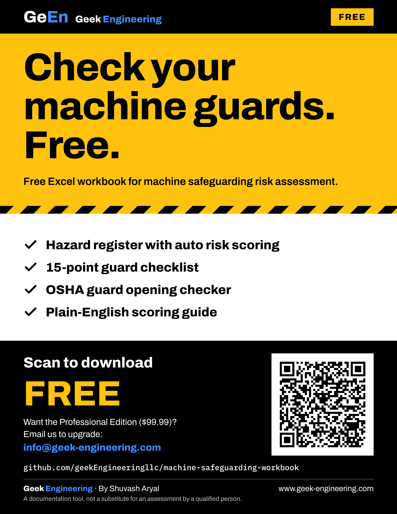

# Machine Safeguarding Risk Assessment Workbook — Free Lite Edition (First Edition)

Free Excel workbook for machine safeguarding risk assessment: a hazard register with automatic risk scoring, a 15-point guard checklist and an OSHA Table O-10 guard opening checker.

**[⬇ Download the Free Lite Edition (.xlsx)](https://github.com/geekEngineeringllc/machine-safeguarding-workbook/raw/main/dist/Machine_Safeguarding_Workbook_FREE_Lite_Edition.xlsx)**

## What's inside

| Sheet | What it does |
|---|---|
| Start Here | Four-step quick start, contents and colour key |
| Hazard Register | 25 rows. Score Severity, Exposure, Probability and Avoidance; the risk score and band (Low → Very high) calculate automatically, before and after controls |
| Scoring Guide | Plain-English definitions for every score; adjustable risk bands |
| Guard Checklist | 15 essential checks: fixed guards, interlocks, emergency stops, lockout and records |
| Guard Openings | Instant pass / fail against OSHA 29 CFR 1910.217 Table O-10 |
| Professional Edition | What the full edition adds |

Follows the risk-assessment approach of ANSI B11.0 and ISO 12100 and supports a basic review under OSHA 29 CFR 1910.212 (machine guarding).

**Who it's for:** plant engineers, maintenance managers, EHS coordinators and machine integrators.

## Need the full toolkit?

The **Professional Edition ($99.99)** adds required Performance Levels (ISO 13849-1), safety-function PL estimates, safety-distance calculators (ISO 13855, OSHA, ANSI B11.19), a 57-point validation checklist, lockout and training records, validation test records and a full User Guide.

**Email us to upgrade:** info@geek-engineering.com · [www.geek-engineering.com](https://www.geek-engineering.com)

Printable flyer: [marketing/GeEn_Free_Lite_Edition_Flyer_Letter.pdf](marketing/GeEn_Free_Lite_Edition_Flyer_Letter.pdf)

## Edition

First Edition, Version 1.0 (2026) · Excel (.xlsx)

By Shuvash Aryal · Published by GeEn — Geek Engineering · AI-assisted, with research from the Ultimate Search Library.

## Licence and disclaimer

© 2026 GeEn — Geek Engineering. Free to use and to share unchanged. Not for resale. See [LICENSE](LICENSE).

This workbook is a documentation tool. It is not legal or engineering advice and does not replace an assessment by a qualified person. Verify references against the current regulations and standards; the employer remains responsible for machine safety.
